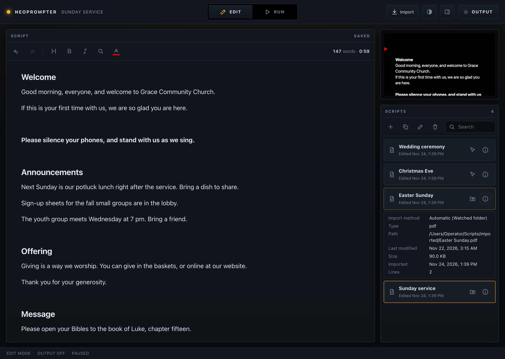
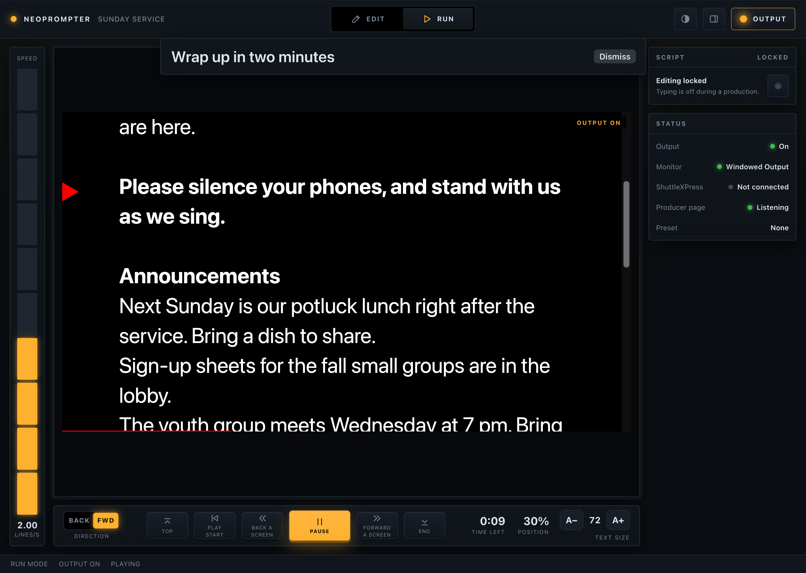
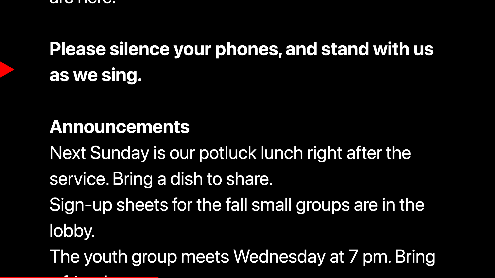
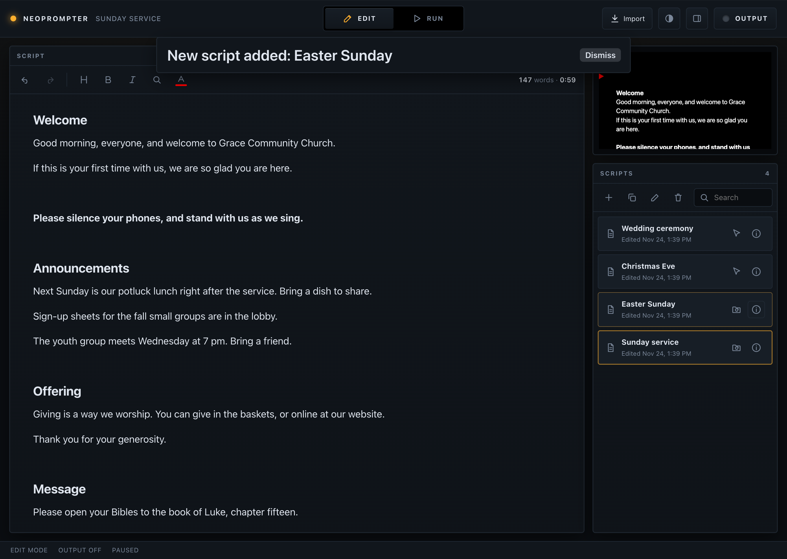
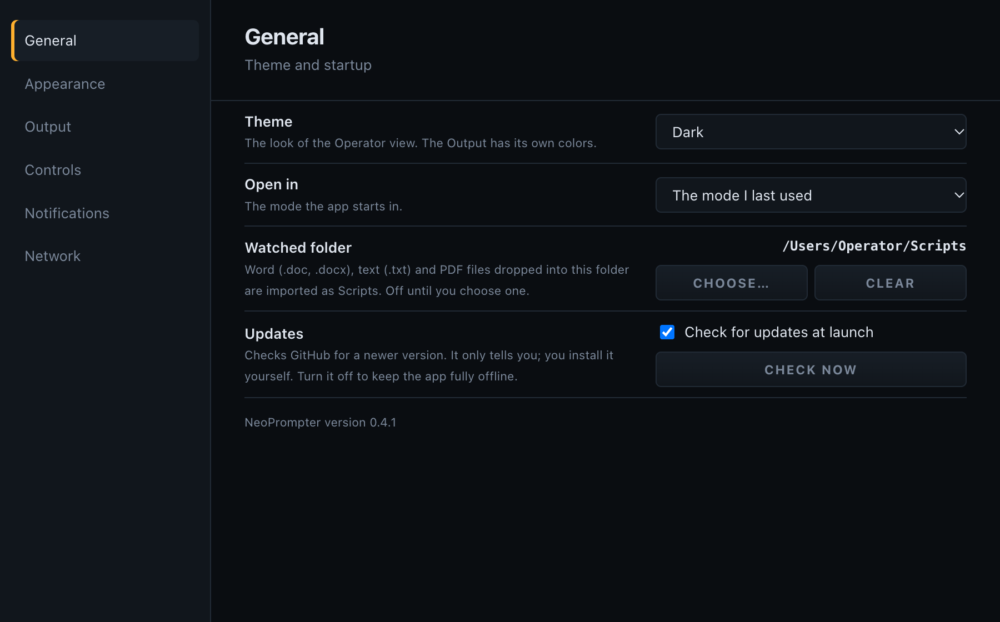
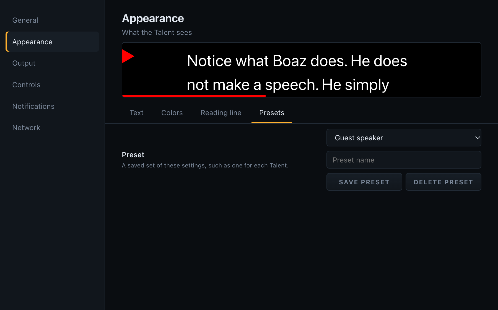

<p align="center">
  
</p>

# NeoPrompter

A desktop teleprompter for a church live production team. One person, the **Operator**, runs it
while the **Producer** and others send them live information.

NeoPrompter is an Electron + TypeScript app for macOS and Windows. It makes no network calls of its
own: the only thing it serves is a small page and API on your local network, for the Producer.

## Screenshots

**Edit mode** is where Scripts are prepared. The Scripts list marks each Script as added by hand
(pointer icon) or imported automatically from the Watched folder (folder icon), and the info
button shows the file's type, path, last modified date, size and when it was imported.



**Run mode** is the live production: speed meter, transport, a Live view that is an exact copy of
what the Talent sees, and a Notification banner from the Producer.



The **Output** is the clean, text-only display for the Talent.



When the Watched folder imports a Script, a **"New script added"** Notification appears.



**Automatic imports.** Choose a **Watched folder** in Preferences, General, and any `.doc`,
`.docx`, `.txt` or `.pdf` file dropped into it becomes a Script, then moves into an `imported/`
subfolder. Nothing is added while you are in Run mode; the files wait until you are back in Edit
mode.



**Presets** save the Output's whole look (text size, spacing, colors, Reading line) under a name,
so one setup can be kept for each Talent or venue and switched in a click.



To retake them after a change, run `npm run build` then `node scripts/readme-screenshots.mjs`.

## What it does

- **Two views for two jobs.** _Edit mode_ is the Script library and a full editor for preparing
  Scripts. _Run mode_ is the live production: transport controls, speed meter, text size buttons and
  a Live view that is an exact, scaled copy of what the Talent sees. The Script is locked against
  typing in Run mode until you deliberately unlock it for a live fix.
- **A clean Output.** A text-only window for the prompter display, always laid out as a 1920x1080
  picture and scaled to fit, so lines wrap and sit in the same place on any monitor. It has a
  Reading line, a Progress bar, mirroring and saved **Presets**, so you can keep several
  configurations (for example one per Talent) and switch between them.
- **Import from Word, text and PDF.** Bring in `.doc`, `.docx`, `.txt` and `.pdf` files as Scripts.
  Word files keep structure, emphasis and colors; text and PDF files come in as plain text. Colors
  too hard to read are replaced with a readable one when shown; the Script keeps the original. Pick
  a **Watched folder** in Preferences and any of these files dropped into it is imported
  automatically, with a "New script added" Notification. Each Script shows whether it was added by
  hand or imported automatically, with its file's details one click away.
- **Notifications from the Producer.** The Producer opens a web page on a phone or laptop and sends
  short messages that appear as banners in the Operator view, never on the Output. **Quick
  messages** are one-tap saved texts, each with an optional color that fills the banner.
- **Companion and other tools.** A small local HTTP API accepts Notifications and reports status
  (Script, state, position, mode, Output on/off, app version). It cannot start, stop or move
  anything.

### Run mode controls

The keys below are the defaults. Each is a Key binding you can change in Preferences, Controls,
Keyboard, and a ShuttleXPress used through its driver software works by sending those keys (see
[docs/shuttlexpress.md](docs/shuttlexpress.md)).

| Control                         | What it does                                                         |
| ------------------------------- | -------------------------------------------------------------------- |
| `Space` / `Shift+Space`         | Play / pause; play back (the same key again pauses)                  |
| `Up` / `Down` arrows            | Faster / slower (hold `Shift` for a bigger step)                     |
| `Left` / `Right`, `PgUp`/`PgDn` | Back / forward a Screen                                              |
| Left click on the Live view     | Toggle stop and play (not while the Script is unlocked)              |
| Middle click                    | Toggle the direction, playing or stopped                             |
| Mouse wheel                     | While playing: speed (down is faster). Paused: scrolls the Script    |
| Drag the text                   | Move through the Script; a playing Script holds still while you drag |
| Scrollbar (right edge)          | Drag to any point in the Script                                      |
| Drag the Reading line           | Place it up or down the Output                                       |

The **Virtual shuttle** (Window menu) is an on-screen copy of a Contour ShuttleXPress, so the
controls can be used and tested without the hardware. The app does not talk to the physical device
yet; use the device's own driver software to send keys instead.

## Getting started

You need Node.js 24 and npm.

```sh
npm install
npm start        # builds the app and launches it
```

On a machine with one display the Output cannot go full screen. Turn on the **Windowed Output** test
setting to see it in an ordinary window.

### Installers

```sh
npm run dist:mac   # release/NeoPrompter-<version>.dmg
npm run dist:win   # release/NeoPrompter Setup <version>.exe
npm run dist:check # confirms the artifacts exist
```

Pushing a version tag such as `v0.2.0` builds all of these on GitHub and drafts a release (see
[docs/installers.md](docs/installers.md#releasing)). Installers are unsigned and there is no auto-update. On macOS, right-click > Open the first time; on
Windows, choose "More info > Run anyway" in SmartScreen. See [docs/installers.md](docs/installers.md).

## Development

```sh
npm run check      # conventions + typecheck + unit tests (the pre-commit hook runs this)
npm test           # unit and jsdom renderer tests (Vitest)
npm run test:e2e   # drives the built app with Playwright and writes screenshots
```

The code is split so that the headless `src/core/` (commands in, state out, no Electron or DOM) is
the one place behaviour lives; the windows are thin renderers of its state.

| Folder                                                                                                       | What is in it                                                       |
| ------------------------------------------------------------------------------------------------------------ | ------------------------------------------------------------------- |
| `src/core/`                                                                                                  | The headless core: `dispatch(command)`, `getState()`, `subscribe()` |
| `src/main/`                                                                                                  | Electron main process and preload; owns the core and bridges IPC    |
| `src/operator/`                                                                                              | The Operator view (Edit and Run mode), React                        |
| `src/preferences/`, `src/shuttle/`                                                                           | The Preferences and Virtual shuttle windows, React                  |
| `src/output/`                                                                                                | The Output renderer, plain TypeScript                               |
| `src/api/`                                                                                                   | The local HTTP API and the Producer page                            |
| `src/import/`, `src/watched-folder/`, `src/library/`, `src/input/`, `src/window-host/`, `src/output-window/` | Headless modules, each with colocated tests                         |

### Documentation

- [GLOSSARY.md](GLOSSARY.md): the project's vocabulary (Operator, Talent, Script, Output, ...). Use
  these terms in code and docs.
- [docs/run-and-test.md](docs/run-and-test.md): the three test seams and how to try the running app
- [docs/scroll-model.md](docs/scroll-model.md): position, speed, Screen jumps, the mouse controls, Key bindings
- [docs/shuttlexpress.md](docs/shuttlexpress.md): using a ShuttleXPress through its driver software
- [docs/script-model-and-import.md](docs/script-model-and-import.md): Script storage, Import, the
  Watched folder, colors
- [docs/api-design.md](docs/api-design.md) and [docs/companion.md](docs/companion.md): the HTTP API,
  the Producer page, and Companion button setup
- [docs/installers.md](docs/installers.md): building and installing
- [docs/adr/](docs/adr/): architecture decisions (why Electron, React + Tiptap, the Script model)
- [CODING_STANDARDS.md](CODING_STANDARDS.md): coding standards

## License

[MIT](LICENSE)
